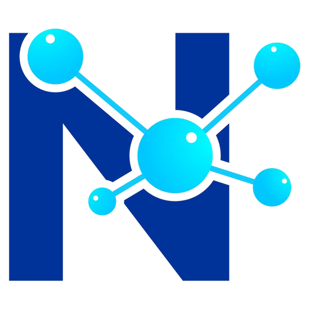

<p align="center"></p>

# NeuroLog

### Surgical Activity Logbook

**Every Case. Every Detail. One Record.**

NeuroLog is a web-based surgical operations logbook designed to help groups of surgeons organize, document, manage and review their surgical activity through a centralized platform.

It provides a structured environment for maintaining surgical case records, tracking team activity and building a searchable history of operative experience.

---

## Overview

Surgical practice involves a large amount of information distributed across different hospitals, operating rooms, surgeons and clinical records.

NeuroLog aims to bring this information together in one organized workspace.

Designed around the needs of surgical teams, the platform provides a centralized approach to recording surgical procedures and maintaining a consistent operational logbook.

Whether used by an individual surgeon or a group of collaborating surgeons, NeuroLog aims to make surgical activity easier to document, retrieve and review.

## Key Objectives

- **Centralized documentation** — Maintain a unified surgical operations logbook.
- **Team collaboration** — Organize surgical activity across multiple surgeons.
- **Structured records** — Record operations using consistent data structures.
- **Searchability** — Retrieve historical surgical cases efficiently.
- **Activity tracking** — Review surgical activity over time.
- **Scalability** — Support the evolving needs of surgical teams and departments.

## Core Concepts

NeuroLog is built around the following concepts:

| Concept | Description |
|---|---|
| Surgical Cases | Individual records of surgical procedures |
| Surgeons | Members of the surgical team |
| Hospitals | Institutions where procedures are performed |
| Procedures | Surgical interventions and their classifications |
| Surgical Activity | Historical overview of the team's operative work |
| Reports | Structured review and analysis of recorded activity |

## Design Philosophy

NeuroLog follows a modern medical SaaS design philosophy.

Its visual identity is based on three primary principles:

- Precision
- Clarity
- Reliability

The NeuroLog brand uses a geometric **N monogram**, inspired by neural pathways and interconnected structures. Logo files, favicons and usage: [docs/brand.md](docs/brand.md).

### Brand Palette

| Color | HEX | Purpose |
|---|---|---|
| Deep Navy | `#17365D` | Primary identity |
| Neuro Cyan | `#20A6B2` | Secondary identity |
| Electric Blue | `#3985D6` | Interactive elements |
| Ice Grey | `#EAF0F5` | Application background |
| Graphite | `#263445` | Typography |
| White | `#FFFFFF` | Content surfaces |

---

## Documentation

Development follows [the implementation plan](docs/implementation-plan.md); milestones **M0 (shell)** and **M1 (schema, code lists, IDs)** are built. The design documents are in [`docs/`](docs/README.md):

| Document | What it holds |
|---|---|
| [Data dictionary](docs/data-dictionary.md) | Every field NeuroLog stores, the classification model, code lists and facets |
| [Implementation plan](docs/implementation-plan.md) | Foundations and milestones |
| [Decision log](docs/decisions.md) | What was decided and why |
| [Open questions](docs/open-questions.md) | What still needs an answer |
| [Naming](docs/naming.md) | Why "NeuroLog" |
| [APYweb seeding plan](docs/seeding/apyweb-seed-plan.md) | Read-only extraction plan to test the code lists against real wording |
| [Code lists](vocab/) | Machine-readable procedures, diagnoses and facets |
| [RF protocol](docs/rf-protocol.md) | One-line format for every RF cycle, with a tested reference parser |
| [Design system](docs/design-system.md) | Palette, typography, spacing and components for the interface |
| [Brand assets](docs/brand.md) | Logo, favicons, social preview, colours |

## Project Status

**Development status:** M0–M4 built: sign-in and roles, schema and code lists, entering operations (chips, quick line, presets), search and patient pages, implants with company and sizes, complications, follow-up with scores and a due list. M2–M4 await the surgeons' acceptance; development uses made-up cases only. Next: M5 (import from APYweb).

NeuroLog is an evolving project. Its functionality, interface and architecture may change as development progresses.

## Technology

- PHP 8.1+ on the ZeusFW framework (`evrokas/zeusfw`), no Composer
- MySQL or MariaDB (utf8mb4)
- Apache with `mod_rewrite` (`deploy/apache-vhost.conf.sample`); `DocumentRoot` is `web/`
- Plain HTML, CSS and JavaScript; no front-end framework, nothing loaded from other hosts
- Sign-in through ErnsAuth (optional per installation; password sign-in otherwise)

## Installation

From the repository root, with a ZeusFW checkout next to it:

```sh
ln -s /path/to/zeusfw fw && ln -s ../fw/core web/core
cp config/site.info.yaml.in config/site.info.yaml
sed -e 's/<<host>>/localhost/;s/<<user>>/neurolog/;s/<<pass>>/PASSWORD/;s/<<db>>/neurolog/' sql/admin.sql.in > sql/admin.sql
sed -e 's/<<host>>/localhost/;s/<<user>>/neurolog/;s/<<pass>>/PASSWORD/;s/<<db>>/neurolog/' config/db.php.in > config/db.php
sudo mysql < sql/admin.sql
mkdir -p var/sessions
fw/bin/update.sh --core-tables=all --web-tables=all --core-diff=yes --web-diff=yes \
                 --content=no --forms=no --generate-feeders=no --non-interactive
php bin/seed_users.php --user=NAME --role=admin      # asks for the password; roles: admin, surgeon, viewer
bin/run_tests.sh
```

`update.sh` creates the tables from `web/classes/yaml/` and loads the code lists from `vocab/` (through
`bin/post-update.sh`); re-run it after pulling a change to either.

For ErnsAuth sign-in: copy `config/ernsauth.php.in` to `config/ernsauth.php`, fill in the address and API key, and
clone the client library to `lib/ernsauth` (see the comment in that file). Without both, the sign-in page offers
the password form only.

Development server: `php -S 127.0.0.1:8097 -t web router.php`.

## Configuration

Environment-specific configuration, database connection details and deployment settings should be maintained outside version control.

Do not commit:

- Database credentials
- API keys
- Authentication secrets
- Private certificates
- Patient-identifiable information
- Production configuration files

Use an environment-specific configuration file and provide a sanitized example configuration where appropriate.

---

## Security and Privacy

NeuroLog is intended for use in a medical environment.

Security and privacy must be considered throughout development, particularly when handling surgical records and potentially identifiable patient information.

Important considerations include:

- Authentication and authorization
- Role-based access control
- Secure session management
- Protection against unauthorized access
- Input validation and output encoding
- Secure data transmission
- Auditability of important operations
- Data backup and recovery
- Compliance with applicable data protection regulations, including GDPR where relevant

**Important:** NeuroLog should not be used with real patient-identifiable information in production until the necessary security, privacy and regulatory requirements have been assessed and implemented.

---

## Development Principles

The project follows these principles:

1. Maintainable and modular code.
2. Clear separation of application logic and presentation.
3. Consistent user interface components.
4. Responsive desktop and mobile experience.
5. Minimal unnecessary dependencies.
6. Preservation of data integrity.
7. Security-conscious development.
8. Incremental improvements without compromising existing functionality.

## Roadmap

The following areas represent potential development directions:

- [ ] Centralized surgical operations logbook
- [ ] Multi-surgeon management
- [ ] Hospital and department management
- [ ] Structured surgical case documentation
- [ ] Advanced search and filtering
- [ ] Surgical activity dashboards
- [ ] Statistics and reporting
- [ ] Exportable surgical logbooks
- [ ] Role-based access management
- [ ] Audit trail and activity history
- [ ] Responsive mobile interface

Roadmap items are indicative and do not necessarily represent currently available functionality.

---

## Contributing

Contributions, suggestions and discussions are welcome.

Before submitting significant changes:

1. Review the existing application architecture.
2. Keep changes consistent with the established design system.
3. Preserve existing functionality.
4. Avoid unnecessary dependencies.
5. Document significant changes.

---

## License

NeuroLog is licensed under the [Apache License, Version 2.0](LICENSE). You may use, copy, modify and distribute it, including commercially, under the terms of that license.

The license covers the code and documentation in this repository. It does not grant permission to use the NeuroLog name, logo or brand (Apache License 2.0, Section 6).

---

## NeuroLog

**Surgical Activity Logbook**

*Every Case. Every Detail. One Record.*
