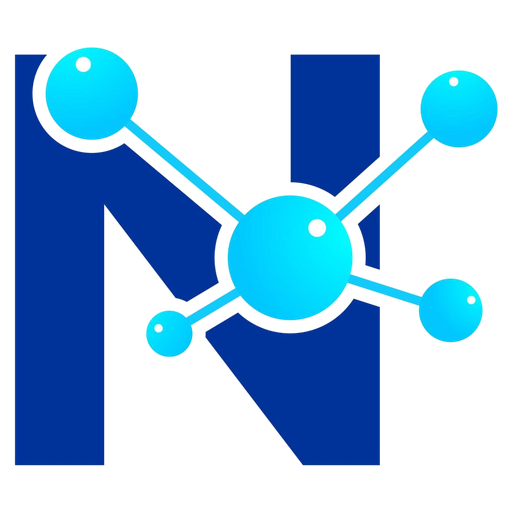

# Brand assets

The NeuroLog logo: a navy **N** with a cyan network of nodes.

<p align="center"></p>

## Files

| File | Use |
| --- | --- |
| `assets/brand/source/neurolog-logo-original.jpg` | Original as supplied (2000×2000, white background). Never edit; regenerate everything from it. |
| `assets/brand/neurolog-logo.png` | Master, transparent background, 1024×1024 |
| `assets/brand/neurolog-logo-512.png` | README, in-app header, documents (transparent) |
| `assets/brand/neurolog-logo-512-white.png` | Where transparency is not supported (white tile) |
| `assets/brand/neurolog-social-preview.png` | GitHub social preview, 1280×640 |
| `assets/brand/neurolog-logo-full.png` / `-full-dark.png` | Full logo: symbol above «NeuroLog» and the tagline (login page, documents) |
| `assets/brand/neurolog-logo-horizontal.png` / `-horizontal-dark.png` | Horizontal logo for the application's navigation bar |
| `assets/brand/neurolog-logo-512-dark.png` | Symbol for dark backgrounds: the N in white, nodes unchanged |
| `assets/brand/neurolog-logo-512-mono.png` / `-mono-white.png` | One-colour symbol (navy / white); rings and highlights become gaps |
| `web/assets/favicon.ico` | Browser tab icon (16, 32, 48 px in one file) |
| `web/assets/favicon-{16,32,48,192,512}x….png` | Browsers and Android that request a specific size |
| `web/assets/apple-touch-icon.png` | iOS home screen, 180×180 on white (iOS fills transparency with black) |
| `web/assets/site.webmanifest` | Name, icons and theme colour for "add to home screen" |

These are the six variants the design system asks for ([design-system.md](design-system.md) §2.2): full, compact (the
symbol), horizontal, monochrome, light background (the transparent files) and dark background (`-dark`). The
wordmark is Inter Bold in the logo navy; it will follow whatever colour question 13 in
[open-questions.md](open-questions.md) settles. All are raster (PNG): for print or large sizes ask the logo's
source for the vector file (SVG/EPS); the design system expects to replace them with final vector artwork.

The white background was removed by flood-filling from the image border, so the white rings around the nodes and the
highlights on them stay white inside the logo. On dark backgrounds the outer parts of those rings are transparent.

## HTML

Every page of the web application includes, in `<head>` (paths relative to the web root):

```html
<link rel="icon" href="assets/favicon.ico" sizes="any">
<link rel="icon" type="image/png" sizes="32x32" href="assets/favicon-32x32.png">
<link rel="icon" type="image/png" sizes="16x16" href="assets/favicon-16x16.png">
<link rel="apple-touch-icon" href="assets/apple-touch-icon.png">
<link rel="manifest" href="assets/site.webmanifest">
<meta name="theme-color" content="#003399">
```

When the PHP app exists, link these through the app's cache-busting asset helper (the family convention: an
`asset_url()` that appends the file's mtime), like every stylesheet.

In-app header: `assets/brand/neurolog-logo-512.png` copied into `web/assets/` and shown at 32–40 px height; on the
dark navy header give it a small white circular backing, as APYweb does with its own logo.

## GitHub

- The README shows the logo at the top.
- **Social preview** (the image shown when the repository link is shared) cannot be set from git: upload
  `assets/brand/neurolog-social-preview.png` in the repository's **Settings → General → Social preview**.

## Colours

Measured from the logo:

| Colour | HEX | In the logo |
| --- | --- | --- |
| Logo navy | `#003399` | The N |
| Logo cyan, dark end | `#00C8F8` | Nodes and links |
| Logo cyan, light end | `#00E8FF` | Node highlights side |

These differ from the brand palette written earlier in the README (Deep Navy `#17365D`, Neuro Cyan `#20A6B2`). One
of the two has to give way before the interface is built; see [open-questions.md](open-questions.md).

## Small sizes

At 16×16 px the five nodes and their links become a few blurred dots and only the N stays readable. If the tab icon
should stay recognisable, a simplified small-size mark (the N with one node) is needed for 16 and 32 px.

## Regenerating

`tools/brand/make_brand.py` rebuilds every file above from the original:

```sh
python3 -I tools/brand/make_brand.py assets/brand/source/neurolog-logo-original.jpg .
```

Needs Python 3 with Pillow and NumPy, and the Inter font for the social preview.
